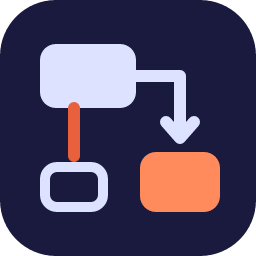

<p align="center"></p>

<h1 align="center">Drawdoro</h1>

<p align="center">
Architecture diagramming and documentation tool: draw software architecture on a tldraw canvas, edit it
together in real time, document each diagram in Markdown and let AI agents read and change it through an MCP
server.
</p>

<p align="center">
<a href="https://github.com/mathmed/drawdoro/actions/workflows/ci.yml"></a>
<a href="https://github.com/mathmed/drawdoro/tree/python-coverage-comment-action-data"></a>
<a href="https://github.com/mathmed/drawdoro/blob/main/LICENSE"></a>
<a href="https://www.python.org/"></a>
<a href="https://nodejs.org/"></a>
<a href="docs/MCP.md"></a>
</p>

Drawdoro is an open-source (MIT) web app for teams that keep their architecture diagrams next to the
documentation that explains them. A FastAPI backend, a React + Vite frontend and a Python MCP server live in one
repository.

## Install

You need [uv](https://docs.astral.sh/uv/) (`make setup` installs it when missing), Node.js 22 or newer, and
Docker for the database (or a PostgreSQL of your own in `DATABASE_URL`).

```sh
git clone https://github.com/mathmed/drawdoro.git
cd drawdoro
make setup     # uv, Python dependencies, git hooks and a .env copied from .env.example
```

## Quick start

Backend, at http://localhost:8000:

```sh
make db                       # Postgres only, in Docker
uv run alembic upgrade head   # apply the database migrations
make run                      # the API with hot reload
```

Frontend, in a separate terminal, at http://localhost:3000:

```sh
cd frontend
npm install
npm run dev
```

Or start everything (API, frontend, MCP server and Postgres) with Docker: `make dev`.

Sign-in is off by default (`AUTH_ENABLED=false`), so you can develop without an identity provider. Check the
API with `curl http://localhost:8000/health` (liveness) and `curl http://localhost:8000/ready` (readiness).

## Features

- **tldraw canvas** for architecture diagrams, organised in workspaces, projects and nestable folders, with
  shape properties, architecture validation, presentation mode and export.
- **Real-time collaboration**: canvas updates, presence avatars and the other people's live cursors, plus a
  sidebar that shows who is in each diagram.
- **Per-diagram docs**: a Markdown documentation page for every diagram, comments anchored to its shapes, and a
  history of revisions that can be restored.
- **Diagram previews** on the project's cards, rendered by the editor in light and dark themes.
- **Personal gallery** of reusable shape selections and images, insertable into any diagram.
- **MCP server for AI agents**: navigate, read, edit, render and comment on diagrams, acting as yourself
  through a personal API key; agents show up in the presence like people do.
- **Workspace roles** (owner, editor, viewer), sign-in with Amazon Cognito and Google, and read-only share links.
- **White-label**: the product name is configuration (`APP_NAME` for the API and the MCP server,
  `VITE_APP_NAME` for the frontend), so a fork rebrands the app and still merges upstream cleanly.

## Configuration

Settings come from environment variables; `.env.example` lists the backend ones with their defaults. The ones
you meet first:

- `DATABASE_URL`: the PostgreSQL async URL (the `make db` container by default).
- `ENV` and `AUTH_ENABLED`: in `production`, the API refuses to start without Cognito sign-in
  (`COGNITO_*` for the API, `VITE_COGNITO_*` for the frontend).
- `SERVICE_API_KEY`: the shared key trusted services such as the MCP server send as `X-API-Key`.
- `APP_NAME` and `VITE_APP_NAME`: the product name shown by the API, the MCP server and the UI.

The full list is in [docs/CONFIGURATION.md](docs/CONFIGURATION.md).

## Repository layout

```
app/        FastAPI backend: domain, infra and presentation layers
frontend/   React + Vite + TypeScript frontend (tldraw, Zustand)
mcp/        Python MCP server for AI agents
docker/     Dockerfile and docker-compose
scripts/    Boot smoke, API contract, OpenAPI diff, suppression ratchet, risk floors, mutation testing
            helpers and the CI Quality Report
docs/       Architecture, configuration, API, MCP and development guides
```

## Connect an AI agent

With the API running, add the MCP server to Claude Code over stdio:

```sh
claude mcp add drawdoro -e MCP_API_URL=http://localhost:8000 -- uv run --directory mcp python server.py
```

The *Connect Claude* dialog in the app generates a personal key and the ready-to-paste command for the HTTP
transport. Tools, transports and keys are in [docs/MCP.md](docs/MCP.md).

## Documentation

| Document | What it covers |
|---|---|
| [Architecture](docs/ARCHITECTURE.md) | Stack, layers, folder structure, domain entities, import contracts, adding a feature |
| [Configuration](docs/CONFIGURATION.md) | Every environment variable of the API, the frontend and the MCP server |
| [Authentication](docs/AUTHENTICATION.md) | Cognito sign-in, workspace roles, app client setup, profile photos |
| [API](docs/API.md) | HTTP and WebSocket routes, health and readiness checks |
| [Real-time](docs/REALTIME.md) | Live cursors and sidebar presence protocols |
| [Features in depth](docs/FEATURES.md) | Diagram previews, history and personal API keys, comments, personal gallery |
| [MCP server](docs/MCP.md) | Agent tools, transports, API keys, rendering, the *Available tools* manifest |
| [White-label](docs/WHITE_LABEL.md) | Rebranding a fork through `APP_NAME`, `VITE_APP_NAME` and friends |
| [Development](docs/DEVELOPMENT.md) | Make targets, frontend checks, loading states, boot smoke, API contract, breaking API changes, suppression ratchet, quality gates, mutation testing, pull requests and risk, Quality Report |

## Contributing

See [`CONTRIBUTING.md`](CONTRIBUTING.md) and [`CLAUDE.md`](CLAUDE.md) (the rules people and AI agents follow
alike), and report security problems privately as [`SECURITY.md`](SECURITY.md) explains. Pull requests follow
[the template](.github/pull_request_template.md) and carry a `risk:<level>` label never below the floor of the
files they touch; AI agents work in two steps, the `coder` agent implements and pushes and the `pr-writer` agent
describes the change and opens the PR (see `CLAUDE.md`).

## License

MIT, see [LICENSE](LICENSE).
